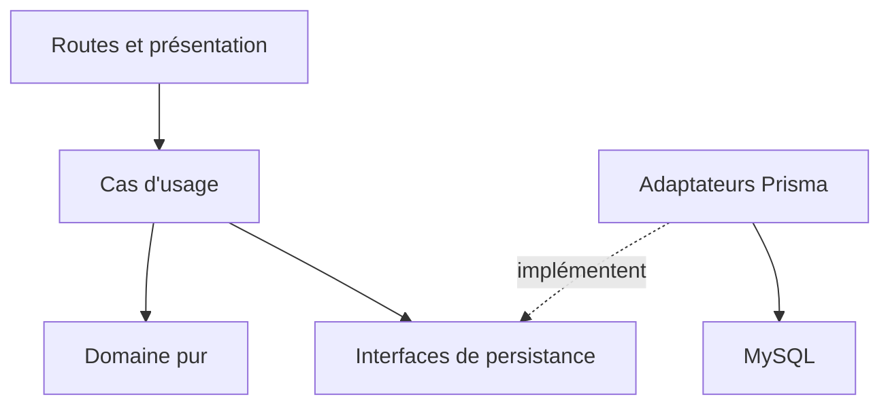

# Architecture du backend

Point d'entrée de M11-02, [backend #46](https://github.com/open-repos/cda-my-happy-wallet-backend/issues/46).
Lire ensuite les [contrats API](api-contracts.md) et le
[parcours de validation](test-environment.md). Ce document décrit l'état intégré
après les tickets #29, #31 et #84, sans introduire une nouvelle architecture.

## Exécution et assemblage

- [src/index.ts](../src/index.ts) connecte le magasin de limitation de débit,
  crée le serveur et écoute `PORT`.
- [src/server.ts](../src/server.ts) assemble en-têtes de sécurité, parseurs
  bornés, sondes, Swagger conditionnel, cookies, CORS, routeur, 404 et gestion
  d'erreurs. En production, un seul saut proxy est déclaré de confiance.
- [src/router.ts](../src/router.ts) monte les routes métier sous `APP_BASE_URL`
  (`/v1` par défaut). Les sondes restent hors de ce préfixe.
- Les `index.ts` des modules assemblent les contrôleurs, cas d'usage et
  adaptateurs avec le client [Prisma partagé](../src/database/index.ts).
  Les fabriques de routeurs acceptent un contrôleur et, pour les modules
  métier récents, un middleware d'authentification injectable pour les tests.

La compilation produit du CommonJS dans `dist/` selon
[tsconfig.json](../tsconfig.json). Le [Dockerfile](../Dockerfile) utilise Node 22,
génère Prisma, compile puis retire les dépendances de développement de l'image
d'exécution. La CI teste également sur Node 22 ; le minimum de l'outillage est
documenté dans [development-toolchain-security.md](development-toolchain-security.md).

## Frontières des modules

Dans les modules récents, les dépendances suivent ces responsabilités :

| Couche                     | Responsabilité                                                                                      | Exemple                                                                                                                                  |
| -------------------------- | --------------------------------------------------------------------------------------------------- | ---------------------------------------------------------------------------------------------------------------------------------------- |
| `domain`                   | Invariants, dates civiles, montants en centimes, calculs déterministes ; pas d'Express ni de Prisma | [MonthlyEvent](../src/modules/monthlyEvents/domain/MonthlyEvent.ts)                                                                      |
| `application`              | Orchestration, identité propriétaire, contrats de dépôts, coordination des écritures                | [OneOffOperationUseCases](../src/modules/operations/application/OneOffOperationUseCases.ts)                                              |
| `infrastructure`           | Requêtes filtrées par propriétaire, conversions SQL/domaine, transactions et pagination             | [PrismaOneOffOperationRepository](../src/modules/operations/infrastructure/PrismaOneOffOperationRepository.ts)                           |
| `presentation` et `routes` | Validation HTTP, DTO publics, statuts et traduction des erreurs                                     | [MonthlyEventController](../src/modules/monthlyEvents/presentation/MonthlyEventController.ts), [routeur](../src/routes/monthlyEvents.ts) |

`user`, `auth` et `operationsFixes` conservent une organisation historique par
cas d'usage et repositories. Le contrôle administrateur de `/users` interroge
directement le repository depuis son middleware et sa liste utilise Prisma
dans le routeur. Ces zones ne sont pas déjà migrées vers les quatre couches.

## Carte fonctionnelle

| Module             | Rôle et liens                                                                                                                                                                                                                                                                               |
| ------------------ | ------------------------------------------------------------------------------------------------------------------------------------------------------------------------------------------------------------------------------------------------------------------------------------------- |
| `user`, `auth`     | Inscription, confirmation, connexion, récupération de mot de passe ; JWT d'accès et sessions de renouvellement persistées. [Routes comptes](../src/routes/user.ts), [routes natives](../src/routes/nativeSession.ts), [RenewSession](../src/modules/auth/renewSession/RenewSession.ts).     |
| `operationsFixes`  | Revenus et charges récurrents historiques, avec calcul pur [ResteAVivreCalculator](../src/modules/operationsFixes/services/ResteAVivreCalculator.ts). Ils alimentent le socle des périodes budgétaires.                                                                                     |
| `operations`       | Catégories personnelles et opérations réelles datées ; une correction d'opération appelle [BudgetCorrectionService](../src/modules/budgetPeriods/application/BudgetCorrectionService.ts). [Contrat](one-off-operation-api.md).                                                              |
| `monthlyEvents`    | Règles de prévision et occurrences calculées pour un mois. Ne crée pas une opération à chaque lecture. [Domaine](monthly-event-domain.md), [persistance](monthly-event-persistence.md).                                                                                                     |
| `eventOccurrences` | Réalisation ou annulation explicite ; instantané de décision, contrôle de rejeu et transaction opération/résolution. [Décision](event-occurrence-resolutions.md).                                                                                                                           |
| `financialGoals`   | Épargne saisie et prévision de versements mensuels ; pas de rapprochement automatique avec les opérations. [Règles et API](financial-goals.md).                                                                                                                                             |
| `budgetPeriods`    | Socle, mouvements réels, report, clôture et projection ; [BudgetPeriodEngine](../src/modules/budgetPeriods/application/BudgetPeriodEngine.ts) dépend du port [BudgetPeriodRepository](../src/modules/budgetPeriods/application/BudgetPeriodRepository.ts). [API](budget-projection-api.md). |
| `analytics`        | Agrégats bornés des opérations réelles, sans addition des prévisions. [API et limites](analytics-api.md).                                                                                                                                                                                   |
| `pagination`       | Paramètres, pages et curseurs opaques communs ; contexte lié à la ressource, au propriétaire et aux filtres. [Contrat](api-pagination.md).                                                                                                                                                  |

## État, effets de bord et infrastructure

Le [schéma Prisma](../src/database/schema.prisma) et les
[migrations versionnées](../src/database/migrations) décrivent l'état SQL.
Les noms de tables historiques français sont conservés ; les adaptateurs
traduisent vers les objets métier. Un DTO HTTP n'est pas une ligne Prisma.

Une synthèse budgétaire peut ouvrir une période et clôturer un mois passé lors
de sa première lecture. Une correction réelle peut recalculer la chaîne de
reports et augmenter les révisions des bilans. Les prévisions seules ne sont
pas des écritures réelles. La réalisation d'occurrence enregistre l'opération
et sa résolution dans une transaction ; son contrat de rejeu n'est pas une
garantie d'idempotence générale pour tous les `POST`.

MySQL porte les comptes, sessions et données financières. Redis porte les
compteurs partagés de limitation de débit, pas les budgets ; sa disponibilité
participe à `/health/ready`. Hors production, sans `REDIS_URL`, un magasin en
mémoire est permis. En production Redis est obligatoire, et une panne ne
désactive pas silencieusement les limites. Voir [la décision Redis](distributed-rate-limiting.md).

L'envoi de courriel passe par [IMailer](../src/modules/user/mail/Mailer.interface.ts)
et [MailerFactory](../src/modules/user/mail/MailerFactory.ts) : SMTP est le
défaut hors production, SendGrid le défaut en production. Les tests injectent
des faux ou utilisent un serveur SMTP local au test. Ce dépôt ne prouve pas
à lui seul qu'une bascule de délivrabilité ou de DNS a été effectuée.

## Décisions et traçabilité maintenues dans ce dépôt

Les documents de décision existants jouent le rôle de références d'architecture.
Les liens `agent-workspace/...` des issues migrées désignent un ancien workspace,
absent de ce clone autonome. Aucune validation d'ADR ou de matrice externe non
accessible n'est supposée. Cette table relie les décisions disponibles,
le backlog GitHub et leurs preuves exécutables.

| Décision / contrat                                          | Référence maintenue                                                                                                   | Issue / preuve                                                                                                                                                                       |
| ----------------------------------------------------------- | --------------------------------------------------------------------------------------------------------------------- | ------------------------------------------------------------------------------------------------------------------------------------------------------------------------------------ |
| Montants exacts, dates civiles et séparation des opérations | [Domaine ponctuel](one-off-operation-domain.md), [persistance](one-off-operation-persistence.md)                      | [#17](https://github.com/open-repos/cda-my-happy-wallet-backend/issues/17), `test:operations-domain`, `test:budget-api-integration`                                                  |
| Pagination commune et isolation                             | [Pagination](api-pagination.md)                                                                                       | [#18](https://github.com/open-repos/cda-my-happy-wallet-backend/issues/18), `test:pagination-integration`                                                                            |
| Récurrence mensuelle et ancrage de fin de mois              | [Événements](monthly-event-domain.md), [cas limites](date-recurrence-tests.md)                                        | [#23](https://github.com/open-repos/cda-my-happy-wallet-backend/issues/23), [#24](https://github.com/open-repos/cda-my-happy-wallet-backend/issues/24), `test:monthly-events-domain` |
| Report, prévision, résolution et correction de bilan        | [Domaine budget](daily-budget-domain.md), [persistance](daily-budget-persistence.md), [API](budget-projection-api.md) | [#29](https://github.com/open-repos/cda-my-happy-wallet-backend/issues/29), `test:budget-projection-api`, `test:budget-corrections`                                                  |
| Contrats HTTP et absence de champs privés                   | [Matrice API](api-characterization-tests.md), [contrats transversaux](api-contracts.md)                               | [#31](https://github.com/open-repos/cda-my-happy-wallet-backend/issues/31), `test:api`, `test:monthly-events-api`, `test:financial-goals-api`                                        |
| Icônes de catégories facultatives                           | [Contrat des icônes](operation-category-icons.md)                                                                     | [#84](https://github.com/open-repos/cda-my-happy-wallet-backend/issues/84), `test:operations-api`                                                                                    |
| Livraison sur GitHub, miroir et production manuelle         | [Contribution](../CONTRIBUTING.md), [automatisation](delivery-automation.md), [CI/CD](ci-cd.md)                       | [Workflows GitHub](../.github/workflows), [pipeline GitLab](../.gitlab-ci.yml)                                                                                                       |

Pour une évolution, partir d'une issue exécutable, modifier la frontière
concernée, préserver le domaine pur et relier la nouvelle preuve dans cette
table ou dans la matrice spécialisée. Une modification publique exige aussi
le fragment de changelog défini dans [changes/README.md](../changes/README.md).

## Validation et retour arrière

Suivre [test-environment.md](test-environment.md) puis vérifier les exemples
HTTP des [contrats](api-contracts.md). Le workflow `Backend quality` exécute
les migrations et les suites SQL sur une base jetable avant génération Prisma
et build. Ni `npm test` seul, ni un test avec un faux dépôt ne prouvent le
fonctionnement des migrations ou l'isolation SQL.

Pour une régression applicative, la procédure de [CI/CD](ci-cd.md) décrit le
retour à l'image précédente ; les migrations SQL ne sont pas annulées avec
l'image. La [sauvegarde/restauration](backup-and-restore.md) et les documents de
persistance détaillent les conditions de reprise. Une correction documentaire
se rétablit par un commit de revert dédié, sans opération sur les données.
